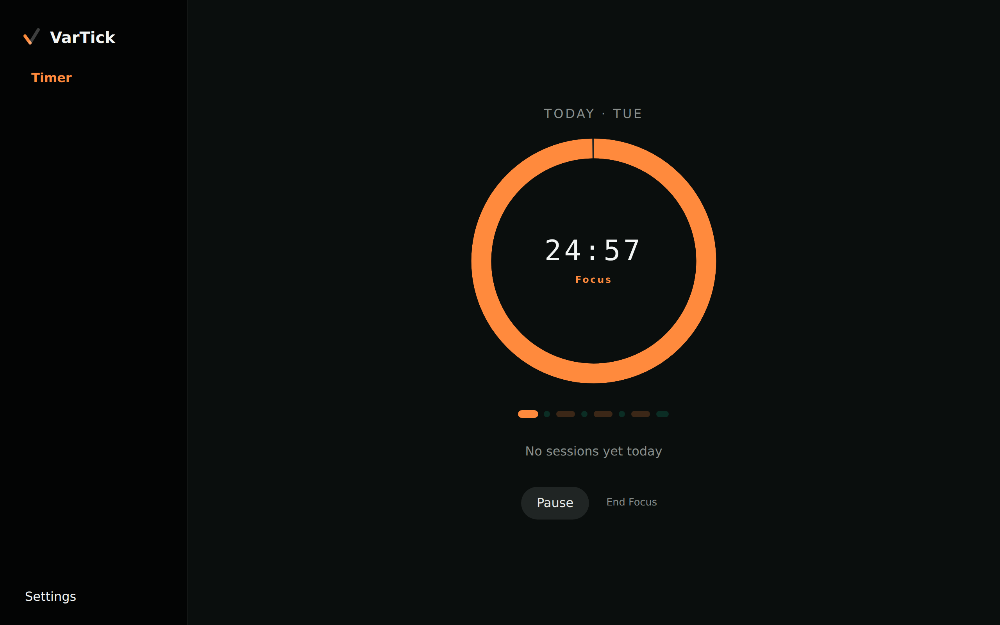
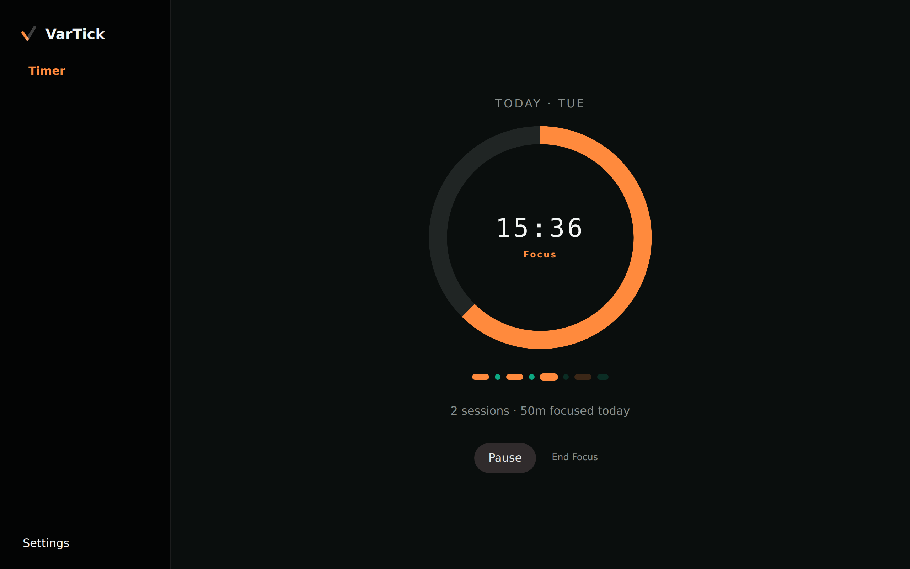
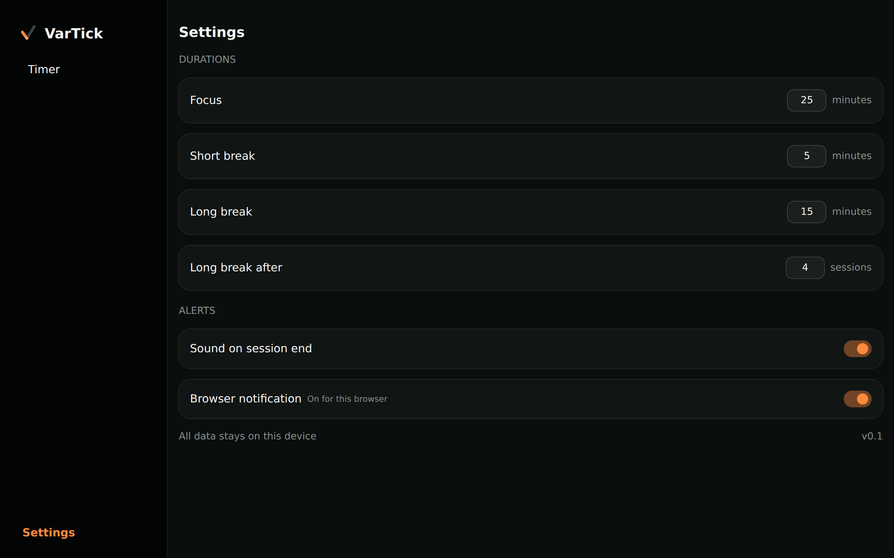
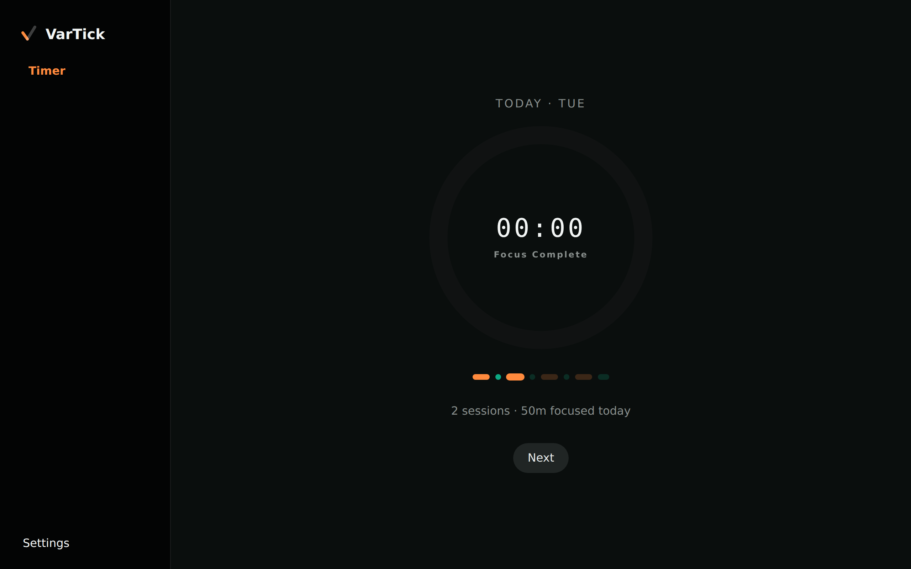
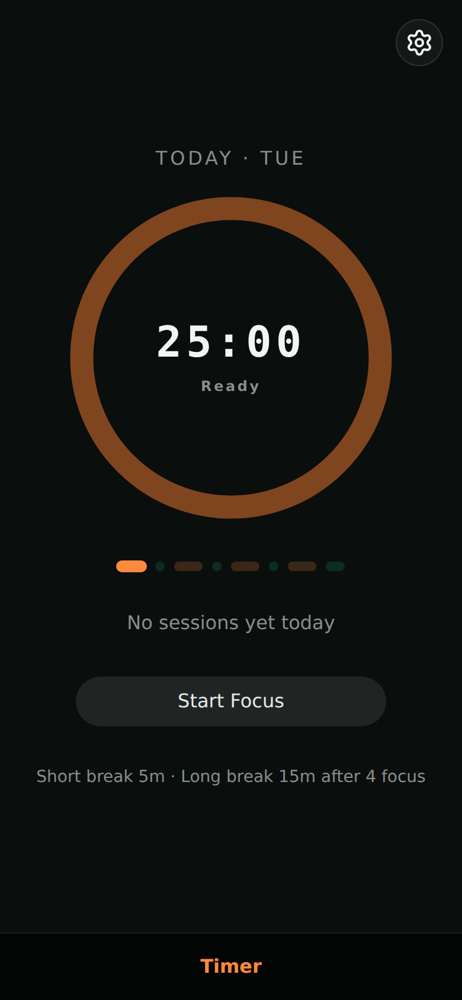

# VarTick

A local-first productivity companion that starts as a Pomodoro timer and grows into a schedule assistant.

**Thesis:** most productivity apps track what you planned. VarTick tracks the _variance_ — the gap between what you planned and what actually happened, and why.

**Live demo:** [vartick.vercel.app](https://vartick.vercel.app/)

> 🚧 Work in progress. See [`docs/`](./docs/README.md) for the full product spec, architecture, and roadmap.

---

## Features

### Focus timer that keeps time in the background



Start, pause, resume, and end focus sessions. The timer stores timestamps instead of counting ticks, so if you leave the tab for 25 minutes, the session shows as finished when you come back instead of still having time left.

### Pomodoro cycles at a glance



Focus sessions alternate with short breaks, and a long break comes after every few focus sessions. The tracker under the timer shows which sessions are done, which one is running, and what's next. Today's completed focus sessions and total focus time are shown beside it.

### Configurable settings



Set how long focus sessions, short breaks, and long breaks last, and how many focus sessions come before a long break. Sound and browser notifications can each be turned on or off.

### Session-end notifications and chimes



When a session ends, VarTick plays a chime and shows a browser notification. Focus endings, break endings, and the end of a full cycle each have their own chime and message.

### Local-first, installable, and offline



Every session is saved to IndexedDB on your device, whether you finished it or gave up early. Nothing is sent to a server. VarTick is a PWA, so you can install it and it keeps working offline through a service worker.

---

## Getting started

Requires Node 22+ (see `.nvmrc`).

```bash
npm install
npm run dev
```

Open [http://localhost:3000](http://localhost:3000).

## Documentation

Full docs live in [`docs/`](./docs/README.md):

- [product.md](./docs/product.md) — what's in scope, what isn't
- [roadmap.md](./docs/roadmap.md) — phases, milestones, cut lines
- [architecture.md](./docs/architecture.md) — data model and ADRs
- [testing.md](./docs/testing.md) — testing strategy
- [design.md](./docs/design.md) — visual design
- [workflow.md](./docs/workflow.md) — branch naming and commit message conventions

## Stack

Next.js (App Router) · TypeScript · Tailwind · shadcn/ui · Dexie (IndexedDB) · Vitest · Playwright · Vercel

## License

TBD
